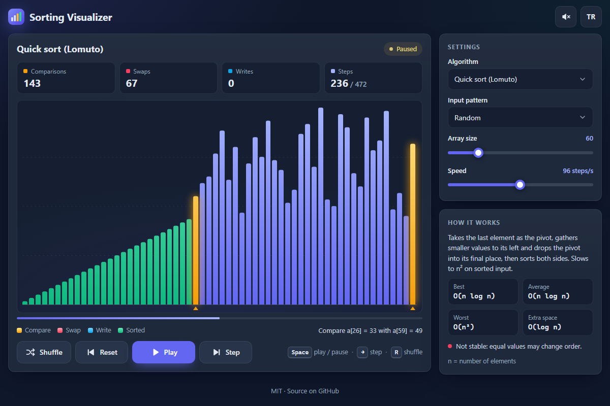

# Sorting Visualizer - watch ten classic sorting algorithms work step by step

[](#tests)
[](LICENSE)

**▶ Open the app: https://celaldrg.github.io/sorting-visualizer/**



## Features

- Ten algorithms: bubble, insertion, selection, Shell, merge, quick sort (Lomuto and Hoare partitions), heap, counting and LSD radix sort.
- A canvas bar chart that stays sharp on high-density screens: amber bars are being compared, red ones swapped, blue ones written, and green ones are in their final place.
- Live counters for comparisons, swaps, writes and elapsed steps, a progress bar and a plain-language narration of every step.
- 5 to 300 bars, 2 to 5,000 steps per second, and four input patterns: random, nearly sorted, reversed and few unique values.
- An info panel for each algorithm: how it works, best, average and worst time, extra space and stability.
- Optional sound: a short tone for each comparison or write, pitched by bar height (off by default).
- English and Turkish. The language and sound choices are remembered.
- No frameworks, no build step, nothing loaded from other sites.

## How to use

1. Pick an algorithm, an input pattern and the array size under **Settings**.
2. Press **Play** to watch the sort, or **Step** to advance one operation at a time. **Speed** can be changed while it runs.
3. **Shuffle** draws a new array; **Reset** rewinds the current one to the start.

| Keyboard | Action |
| --- | --- |
| `Space` | Play / pause |
| `→` | One step |
| `R` | Shuffle |

On a touch screen, tap the chart to play or pause.

Add `?demo` to the address for a fixed scene: quick sort paused halfway through a 60-element random array.

## Run locally

The app uses ES modules, so it has to be served over `http://`; opening `index.html` straight from the disk does not work.

```sh
npx serve .
```

Then open the address it prints (usually http://localhost:3000).

## Tests

The sorting logic, playback and UI helpers are plain modules that do not touch the DOM. They are tested with Node's built-in test runner (Node 22 or newer, no dependencies):

```sh
node --test
```

What the tests cover:

- **Done criterion:** for every algorithm, its own steps replayed on a copy sort 200 seeded arrays (sizes 0, 1, 2, 10, 50 and 200; duplicates, already sorted, reversed, negative values) exactly like `Array.prototype.sort` with a numeric comparator.
- **Stability:** bubble, insertion, merge, counting and radix sort keep records with equal keys in input order; every sort flagged as unstable is shown to reorder some.
- **Step counts:** the same seed always gives the same steps and counters, and the counts for a seeded 100-element array are pinned. Textbook counts hold too, such as one swap per inversion, and quick sort never keeps more than log2(n) parts waiting on its stack.
- **Steps:** every step is well-formed, and each bar is marked sorted exactly once, only when it is final.
- **Languages:** English and Turkish have the same keys and placeholders, and every key the page or the code uses exists in both.
- **Storage:** the localStorage helper falls back to the defaults when storage is missing or throws, as in private mode.
- **Interface helpers:** the playback controller and the `?demo` scene, keyboard shortcuts, bar layout, step narration and tone pitch.

## Project structure

```
index.html            page markup
style.css             dark theme, mobile-first layout
src/
  main.js             entry point: wires controls, keyboard, chart taps and the frame loop
  view.js             DOM rendering: counters, status, settings and info panel
  chart.js            canvas bar chart (devicePixelRatio aware)
  bars.js             bar layout and color roles
  describe.js         status, step narration and complexity notation
  keyboard.js         keyboard shortcuts
  audio.js            optional Web Audio tones
  i18n.js             English and Turkish strings
  storage.js          localStorage wrapper that never throws
  visualizer.js       playback controller: settings, play, pause, step, demo scene
  player.js           applies steps and counts comparisons, swaps and writes
  sorts.js            the ten algorithms as step generators
  algorithms.js       algorithm catalogue: stability and complexity
  arrays.js           input patterns
  rng.js              seeded random number generator
test/                 node:test suites
docs/screenshot.png   screenshot for this README
```

## License

[MIT](LICENSE) © 2026 Celalettin Durgaç

## Türkçe

On klasik sıralama algoritmasını animasyonlu bir çubuk grafikte adım adım izleyin; karşılaştırma, takas ve yazma sayaçları canlı güncellenir.

**▶ Uygulamayı aç: https://celaldrg.github.io/sorting-visualizer/**

### Özellikler

- On algoritma: kabarcık, eklemeli, seçmeli, Shell, birleştirmeli, hızlı sıralama (Lomuto ve Hoare bölümlemesi), yığın, sayma ve LSD radix sıralaması.
- Yüksek çözünürlüklü ekranlarda da keskin kalan bir canvas grafiği: sarı çubuklar karşılaştırılıyor, kırmızılar takas ediliyor, maviler yazılıyor, yeşiller son yerinde.
- Karşılaştırma, takas, yazma ve geçen adım sayaçları, bir ilerleme çubuğu ve her adımın sade bir anlatımı.
- 5 ile 300 arası çubuk, saniyede 2 ile 5.000 arası adım ve dört girdi düzeni: rastgele, neredeyse sıralı, ters sıralı, az sayıda farklı değer.
- Her algoritma için bilgi paneli: nasıl çalıştığı, en iyi, ortalama ve en kötü süre, ek bellek ve kararlılık.
- İsteğe bağlı ses: her karşılaştırma ya da yazmada çubuk yüksekliğine göre kısa bir ton (varsayılan olarak kapalı).
- İngilizce ve Türkçe. Dil ve ses tercihi hatırlanır.
- Çatı (framework) yok, derleme adımı yok, başka sitelerden bir şey yüklenmez.

### Nasıl kullanılır

1. **Ayarlar** bölümünden algoritmayı, girdi düzenini ve dizi boyutunu seçin.
2. Sıralamayı izlemek için **Oynat**'a, işlemleri tek tek ilerletmek için **Adım**'a basın. **Hız** çalışırken de değiştirilebilir.
3. **Karıştır** yeni bir dizi çeker; **Sıfırla** mevcut diziyi başa sarar.

| Klavye | İşlev |
| --- | --- |
| `Boşluk` | Oynat / duraklat |
| `→` | Bir adım |
| `R` | Karıştır |

Dokunmatik ekranda grafiğe dokunmak oynatır ya da duraklatır.

Adresin sonuna `?demo` eklerseniz sabit bir sahne açılır: 60 elemanlı rastgele bir dizide yarıda duraklatılmış hızlı sıralama.

### Yerelde çalıştırma

Uygulama ES modülleri kullandığı için `http://` üzerinden sunulmalıdır; `index.html` dosyasını doğrudan diskten açmak çalışmaz.

```sh
npx serve .
```

Ardından yazdırdığı adresi açın (genellikle http://localhost:3000).

### Testler

Sıralama mantığı, oynatma ve arayüz yardımcıları DOM'a dokunmayan sade modüllerdir. Node'un yerleşik test çalıştırıcısıyla test edilir (Node 22 ya da üstü, bağımlılık yok):

```sh
node --test
```

Testlerin kapsadıkları:

- **Bitti ölçütü:** her algoritmanın kendi adımları bir kopya üzerinde yeniden oynatıldığında, sabit tohumla üretilmiş 200 diziyi (0, 1, 2, 10, 50 ve 200 elemanlı; tekrarlı, zaten sıralı, ters sıralı, negatif değerli) sayısal karşılaştırıcılı `Array.prototype.sort` ile birebir aynı sıralar.
- **Kararlılık:** kabarcık, eklemeli, birleştirmeli, sayma ve radix sıralaması eşit anahtarlı kayıtları girdi sırasında tutar; kararsız diye işaretlenen her sıralamanın bazı eşit anahtarların sırasını değiştirdiği gösterilir.
- **Adım sayıları:** aynı tohum her zaman aynı adımları ve sayaçları verir; tohumlu 100 elemanlı bir dizinin sayıları sabitlenmiştir. Ders kitabındaki sayılar da tutar: örneğin ters sıralı her çift için bir takas; hızlı sıralama da yığınında aynı anda en çok log2(n) parça bekletir.
- **Adımlar:** her adım geçerli biçimdedir; her çubuk yalnızca son yerine oturduğunda ve tam bir kez sıralı işaretlenir.
- **Diller:** İngilizce ve Türkçe aynı anahtarlara ve yer tutuculara sahiptir; sayfanın ya da kodun kullandığı her anahtar iki dilde de vardır.
- **Depolama:** localStorage yardımcısı, depolama yoksa ya da hata verirse (gizli modda olduğu gibi) varsayılan değerlere döner.
- **Arayüz yardımcıları:** oynatma denetleyicisi ve `?demo` sahnesi, klavye kısayolları, çubuk yerleşimi, adım anlatımı ve ton yüksekliği.

### Lisans

[MIT](LICENSE) © 2026 Celalettin Durgaç
